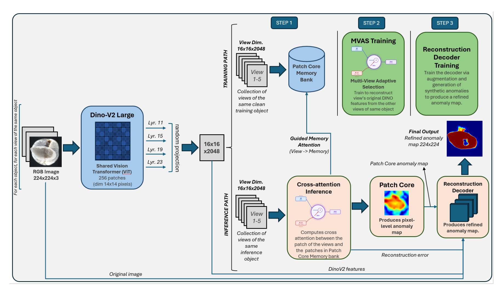

# Industrial Few-shot Anomaly Detection

Project for the **Advanced Deep Learning (ADL)** course at **Politecnico di Milano** (Prof. Giacomo Boracchi, Prof. Matteo Matteucci).


- 📄 **Link report:** [ADL_Project_Report](https://github.com/Saiukk/ADL/blob/master/ADL_Project_Report.pdf)
- 💻 **Link work:** [Anomaly detection](https://github.com/Saiukk/ADL/blob/master/anomaly_detection.ipynb)

---

## The challenge

A **multi-view image anomaly detection** task on objects (mechanical gears, electronic components, coffee beans, etc.) that will be used as supplies for a space mission to Mars. The goal is a deep learning pipeline that detects **structural anomalies** and produces pixel-wise anomaly maps.

We work in the **semi-supervised, feature-based AD** setting: a pretrained backbone extracts latent features, and anomalies are detected statistically in that latent space.

**Data provided**
- Clean training samples for each object category
- One anomalous training sample per anomaly type, with GT masks (a handful of defective examples)
- An unlabeled test set of normal and anomalous samples
- Short textual descriptions of each anomaly type
- Five views per object, each with its own GT mask

---

## Our solution




1. **Frozen DINOv2-Large backbone.** Tokens from layers 11, 15, 19 and 23 are concatenated and randomly projected to 2048 dims, giving a 16×16×2048 feature map per view.
2. **PatchCore.** A coreset memory bank (ratio 0.2, ~100k patches per class) is built from normal images; each test patch is scored by its 1-NN distance to the bank.
3. **MVAS + Guided Memory Attention.** A lightweight cross-attention module (MVAS) is trained self-supervised on normal images to reconstruct each view's features from the other views (window-based top-k selection, MSE loss). At inference, patches attend to the *normal* memory bank instead of to each other, and the cosine reconstruction error highlights anomalies. This avoids anomalies in one view being cancelled out by the others.
4. **Supervised refinement decoder.** A lightweight CNN fuses the reconstruction error, the PatchCore map, DINO features and the RGB image into one sharper anomaly map. It is trained with Dice + Focal BCE on real normal, real anomalous and **synthetic anomalies** (copy-paste of real anomalies onto clean images, plus augmentations).
5. **Ensembling.** PatchCore and the supervised segmentation networks are combined, with test-time augmentation (TTA) and multi-scale fusion.

---

## Results

| Pipeline | AP (9 industrial categories) |
|---|---|
| PatchCore baseline (DINO + MVAS + PatchCore) | 0.53 |
| **Full pipeline (refinement decoder + ensemble)** | **0.81** |

**Notes:** background removal with Lang-SAM failed because the background was zeroed instead of removed, so PatchCore learned black regions as "normal". Future work: enrich the anomaly descriptions with a text model and use a diffusion model to generate better synthetic anomalies with masks.

---

## Repository

```
├── anomaly_detection.ipynb   # Training and inference
├── ADL_Project_Report.pdf    # Report
└── README.md
```

## References

1. H. He et al. *Learning multi-view anomaly detection with efficient adaptive selection*, 2025.
2. M. Oquab et al. *DINOv2: Learning robust visual features without supervision*, 2024.
3. K. Roth et al. *Towards total recall in industrial anomaly detection*, 2022.
